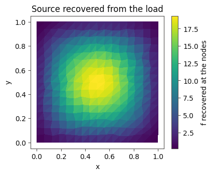
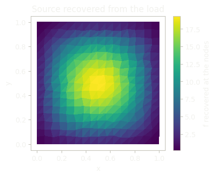
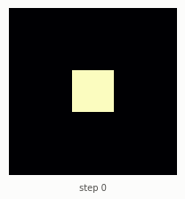
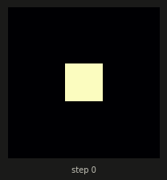
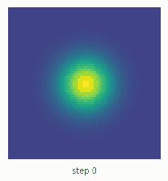
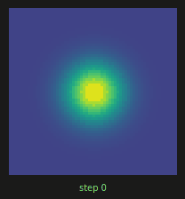
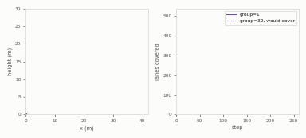
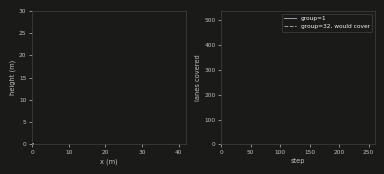
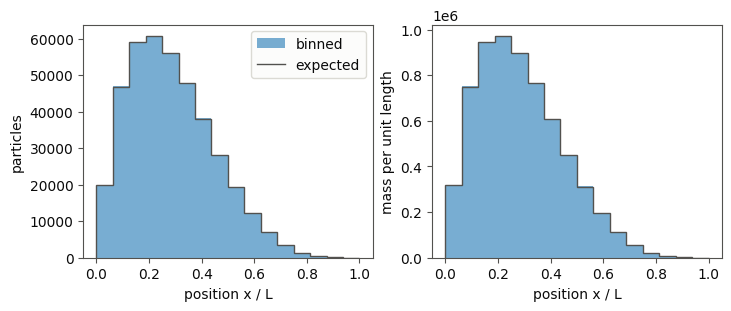
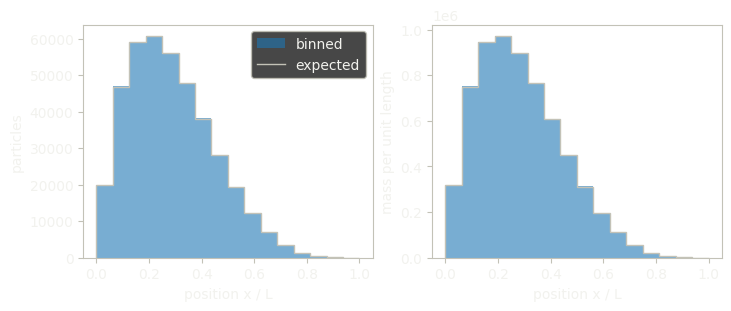

# In your field

The same kernel language, five fields. A *lane* is one run of the kernel body, and a *sample* is one independent element of work. Each card links two ways in: **write the kernel** in hawk, or **compose the flow**
around it in eagle (graphs, loops, copies, early stop). Every example runs on a CPU at a small size and on a GPU at a
larger one. The pictures here are from those notebooks; nothing on this page is a timing.

```{raw} html
<div class="rpt-gallery">

<figure class="rpt-card">
  
  
  <figcaption>
    <h3>Finite elements</h3>
    <p>Each triangle hands a share of its load to its three corners, and a node shared by several triangles collects them all.</p>
    <p class="links"><a href="https://amasat01.github.io/hawk/content/vocabulary/07_fem_assembly.html">Write the kernel</a>
    <a href="https://amasat01.github.io/eagle/content/userguide/tutorials/24_fem_solve_early_stop.html">Compose the flow</a></p>
  </figcaption>
</figure>

<figure class="rpt-card">
  
  
  <figcaption>
    <h3>Heat diffusion</h3>
    <p>A grid of cells, each stepped from its four neighbours; the animation is the plate cooling.</p>
    <p class="links"><a href="https://amasat01.github.io/hawk/content/vocabulary/09_heat_diffusion.html">Write the kernel</a>
    <a href="https://amasat01.github.io/eagle/content/userguide/tutorials/22_heat_energy_check.html">Compose the flow</a></p>
  </figcaption>
</figure>

<figure class="rpt-card">
  
  
  <figcaption>
    <h3>Fluids</h3>
    <p>Shallow water on a 2-D grid, with the total water checked at the end.</p>
    <p class="links"><a href="https://amasat01.github.io/hawk/content/vocabulary/10_fluids.html">Write the kernel</a>
    <a href="https://amasat01.github.io/eagle/content/userguide/tutorials/23_fluids_pinned_frames.html">Compose the flow</a></p>
  </figcaption>
</figure>

<figure class="rpt-card">
  
  
  <figcaption>
    <h3>Monte Carlo trajectories</h3>
    <p>An ensemble of projectiles, each stopping at its own impact; finished ones leave the launch.</p>
    <p class="links"><a href="https://amasat01.github.io/hawk/content/vocabulary/12_monte_carlo_ensemble.html">Write the kernel</a>
    <a href="https://amasat01.github.io/eagle/content/userguide/tutorials/21_monte_carlo_early_termination.html">Compose the flow</a></p>
  </figcaption>
</figure>

<figure class="rpt-card">
  
  
  <figcaption>
    <h3>Particle binning</h3>
    <p>Add each particle's weight into its cell; if the particles are already sorted by cell, each run of the same cell is added in one go.</p>
    <p class="links"><a href="https://amasat01.github.io/hawk/content/vocabulary/08_particle_binning.html">Write the kernel</a>
    <a href="https://amasat01.github.io/eagle/content/userguide/tutorials/25_particle_binning_stream.html">Compose the flow</a></p>
  </figcaption>
</figure>

</div>
```

Not your field? These are the same few words: a grid of lanes, a read of a neighbour, a sum or a scatter across lanes.
[Batched small matrices](https://amasat01.github.io/hawk/content/vocabulary/11_batched_contraction.html) shows the
plainest use of them, checked against `einsum`.
