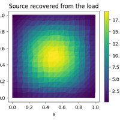
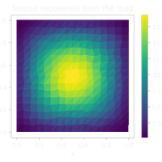
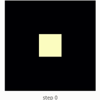
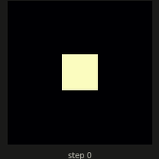
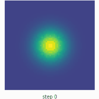
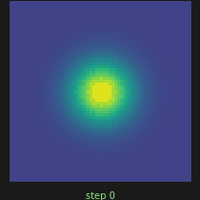
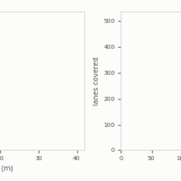
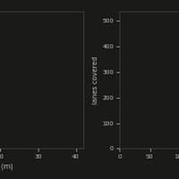
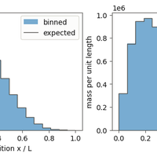
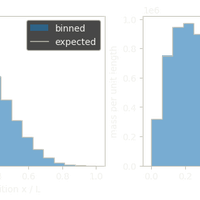

# RAPTOR

```{raw} html
<header class="rpt-bar">
  <a class="rpt-brand" href="#"><span>RAPTOR</span></a>
  <nav aria-label="Main"><a href="start_here.html">Start here</a><details class="rpt-docs"><summary>Docs</summary><div class="rpt-docs-list"><a href="https://amasat01.github.io/eagle/">eagle<small>launch, graphs, compaction</small></a><a class="rpt-sub" href="https://amasat01.github.io/eagle/content/userguide/tutorials_python.html">eagle Tutorials</a><a class="rpt-sub" href="https://amasat01.github.io/eagle/content/userguide/howto.html">eagle How-to guides</a><a class="rpt-sub" href="https://amasat01.github.io/eagle/content/performance.html">eagle Performance</a><a href="https://amasat01.github.io/hawk/">hawk<small>write the kernel</small></a><a class="rpt-sub" href="https://amasat01.github.io/hawk/content/tutorials.html">hawk Tutorials</a><a class="rpt-sub" href="https://amasat01.github.io/hawk/content/examples.html">hawk How-to guides</a><a class="rpt-sub" href="https://amasat01.github.io/hawk/content/domains.html">hawk Domains</a><a href="https://amasat01.github.io/raptor/">raptor<small>the shared contracts</small></a><a class="rpt-sub" href="https://amasat01.github.io/raptor/content/tutorials.html">raptor Tutorials</a><a class="rpt-sub" href="https://amasat01.github.io/raptor/content/howto.html">raptor How-to guides</a><a href="https://amasat01.github.io/aether/">aether<small>the C++ underneath</small></a><a class="rpt-sub" href="https://amasat01.github.io/aether/content/tutorials.html">aether Tutorials</a><a class="rpt-sub" href="https://amasat01.github.io/aether/content/examples.html">aether How-to guides</a></div></details><a href="compare.html">Compare</a><a href="https://github.com/amasat01">GitHub</a>
  <script>
  document.write(`
    <button class="btn btn-sm nav-link pst-navbar-icon theme-switch-button rpt-theme-toggle" title="light/dark" aria-label="light/dark" data-bs-placement="bottom" data-bs-toggle="tooltip">
      <i class="theme-switch fa-solid fa-sun fa-lg" data-mode="light"></i>
      <i class="theme-switch fa-solid fa-moon fa-lg" data-mode="dark"></i>
      <i class="theme-switch fa-solid fa-circle-half-stroke fa-lg" data-mode="auto"></i>
    </button>
  `);
  </script>
  </nav>
</header>
<div class="rpt-hero">
  <h1><span>Write the code for one sample.</span> <span>Run a million of them.</span></h1>
  <p class="rpt-sub">One sample is one independent simulation: you write its step once, in Python.</p>
</div>
```

```{include} _generated/lead_sentence.md
```

```{raw} html
<div class="rpt-actions" id="start">
  <a class="btn" href="start_here.html">Start here</a>
  <a class="quiet" href="https://github.com/amasat01/amasat01.github.io/raw/main/notebooks/raptor_start_here.ipynb">Download the notebook</a>
  <a class="quiet" href="https://colab.research.google.com/github/amasat01/amasat01.github.io/blob/main/notebooks/raptor_start_here.ipynb">Open in Colab</a>
  <code>pip install "raptor-hawk[cuda12]" "raptor-eagle[cuda12]"</code>
  <span class="rpt-cpu"><code>pip install raptor-hawk raptor-eagle</code> without an NVIDIA GPU (the CPU route). Wheels are Linux x86_64; macOS and Windows <a href="build_from_source.html">build from source</a>.</span>
</div>
```

```{raw} html
<figure class="rpt-thread">
  <svg id="thread" role="img" aria-label="One ink stroke splits into many thin lines, one per sample; each line stops at its own length and ends in a drop, and most stop early."></svg>
  <figcaption>Each line is a sample; each drop is where it finished.</figcaption>
</figure>
<script>RaptorThread.mount(document.getElementById("thread"), { desktopSamples: 150, phoneSamples: 60, seed: 20261001 });</script>
```

```{raw} html
<p class="rpt-why"><b>Let mathematics reveal the structure of physics. Let modern computing carry the computational burden.</b> <a href="why.html">Why RAPTOR is built this way</a></p>
```

(story)=
## Versatile, lean, performant

```{raw} html
<ol class="rpt-words" aria-label="Three words used on this page">
  <li>
    <svg viewBox="0 0 96 64" role="img" aria-label="One dot"><circle cx="48" cy="32" r="9" class="f-raptor"/></svg>
    <b>sample</b><span>one independent simulation</span>
  </li>
  <li>
    <svg viewBox="0 0 96 64" role="img" aria-label="A grid of cells, one dot in each"><g class="s-muted"><rect x="18" y="8" width="60" height="48" rx="3"/><path d="M38 8v48M58 8v48M18 24h60M18 40h60"/></g><g class="f-raptor"><circle cx="28" cy="16" r="3.5"/><circle cx="48" cy="16" r="3.5"/><circle cx="68" cy="16" r="3.5"/><circle cx="28" cy="32" r="3.5"/><circle cx="48" cy="32" r="3.5"/><circle cx="68" cy="32" r="3.5"/><circle cx="28" cy="48" r="3.5"/><circle cx="48" cy="48" r="3.5"/><circle cx="68" cy="48" r="3.5"/></g></svg>
    <b>lane</b><span>one run of the kernel body, on a line or a grid</span>
  </li>
  <li>
    <svg viewBox="0 0 96 64" role="img" aria-label="A card with a small bar chart"><rect x="22" y="6" width="52" height="52" rx="6" class="s-muted card-bg"/><g class="f-raptor"><rect x="31" y="34" width="8" height="16"/><rect x="44" y="22" width="8" height="28"/><rect x="57" y="14" width="8" height="36"/></g></svg>
    <b>card</b><span>a measured record for one device</span>
  </li>
</ol>
```

### Versatile

```{raw} html
<p class="rpt-line">One kernel, many fields. Pick one to see a worked case, on a CPU and on a GPU.</p>
<div class="rpt-domains">
  <a href="https://amasat01.github.io/hawk/content/domains.html#mechanics-and-fluids"><svg viewBox="0 0 32 32" aria-hidden="true"><ellipse cx="16" cy="16" rx="13" ry="7" class="s-ink" transform="rotate(-25 16 16)"/><circle cx="16" cy="16" r="3" class="f-raptor"/><circle cx="26" cy="10" r="2" class="f-ink"/></svg><b>Mechanics and fluids</b><span>orbits, heat, water, metal</span></a>
  <a href="https://amasat01.github.io/hawk/content/domains.html#particles-and-radiation"><svg viewBox="0 0 32 32" aria-hidden="true"><path d="M4 26C10 24 12 8 18 8s6 14 10 16" class="s-ink" fill="none"/><circle cx="8" cy="22" r="2" class="f-raptor"/><circle cx="18" cy="8" r="2" class="f-raptor"/><circle cx="26" cy="22" r="2" class="f-raptor"/></svg><b>Particles and radiation</b><span>bins, histories, tracks</span></a>
  <a href="https://amasat01.github.io/hawk/content/domains.html#reactions-and-life-sciences"><svg viewBox="0 0 32 32" aria-hidden="true"><path d="M13 4h6M14 4v9L7 26a2 2 0 0 0 2 3h14a2 2 0 0 0 2-3l-7-13V4" class="s-ink" fill="none"/><circle cx="14" cy="23" r="1.8" class="f-raptor"/><circle cx="19" cy="20" r="1.4" class="f-raptor"/></svg><b>Reactions and life sciences</b><span>reactors, enzymes, epidemics</span></a>
  <a href="https://amasat01.github.io/hawk/content/domains.html#energy-finance-and-control"><svg viewBox="0 0 32 32" aria-hidden="true"><path d="M18 3L7 18h8l-2 11 11-15h-8z" class="s-ink f-raptor-soft"/></svg><b>Energy, finance and control</b><span>grids, options, servos</span></a>
  <a href="https://amasat01.github.io/hawk/content/domains.html#signals-and-data"><svg viewBox="0 0 32 32" aria-hidden="true"><path d="M2 16c3-12 6-12 9 0s6 12 9 0 5-8 10-4" class="s-raptor" fill="none"/><path d="M2 16h28" class="s-muted" fill="none"/></svg><b>Signals and data</b><span>small matrices, filters</span></a>
</div>
<ul class="rpt-chips" aria-label="Also built in">
  <li>per-lane linear algebra</li><li>broadcasting</li><li>grids</li><li>keyed sums and scatters</li><li>derivatives through loops and branches</li><li>embedded C</li><li>graphs mixing host and GPU steps</li>
</ul>
<a class="rpt-thumbs" href="gallery.html" aria-label="The gallery: five fields in pictures">
  <span></span>
  <span></span>
  <span></span>
  <span></span>
  <span></span>
  <em>See the gallery</em>
</a>
```

### Lean

```{raw} html
<div class="rpt-lean">
  <div><svg viewBox="0 0 32 32" aria-hidden="true"><path d="M5 12l11-7 11 7v10l-11 7-11-7z" class="s-raptor" fill="none"/><path d="M5 12l11 7 11-7M16 19v10" class="s-muted" fill="none"/></svg><b>Header-only C++</b><span>Nothing extra to link.</span></div>
  <div><svg viewBox="0 0 32 32" aria-hidden="true"><rect x="4" y="12" width="24" height="8" rx="2" class="s-ink" fill="none"/><rect x="6" y="14" width="9" height="4" class="f-raptor"/></svg><b>Low memory</b><span>A million samples sit close to the bare minimum state (third card below).</span></div>
  <div><svg viewBox="0 0 32 32" aria-hidden="true"><circle cx="16" cy="16" r="11" class="s-raptor" fill="none"/><path d="M10 16.5l4 4 8-9" class="s-ink" fill="none"/></svg><b>Unused features cost nothing</b><span>Same code, same launch speed; tests check it against the previous release.</span></div>
</div>
```

### Performant

```{include} _generated/hero_strip.md
```

**[Where it ties](compare.md):**

```{include} _generated/honest_box.md
```

```{raw} html
<div class="rpt-fit">
  <div class="rpt-good">
    <h4>Good for</h4>
    <ul>
      <li>independent per-element updates</li>
      <li>grids and stencils</li>
      <li>ensembles whose samples stop early</li>
      <li>assembly and binning</li>
      <li>graphs mixing host and GPU steps</li>
    </ul>
  </div>
  <div class="rpt-hands">
    <h4>Hands off to others</h4>
    <ul>
      <li>dense tensors and training: PyTorch or JAX, arrays cross without a copy</li>
      <li>sparse direct solvers: not covered</li>
      <li>several GPUs or MPI ranks: not in the docs yet</li>
    </ul>
  </div>
</div>
<div class="rpt-libs" aria-label="The four libraries">
  <a class="rpt-lib hawk" href="https://amasat01.github.io/hawk/"><b>hawk</b><span>write the kernel, in Python</span><small>Start here</small></a>
  <span class="rpt-arrow" aria-hidden="true"></span>
  <a class="rpt-lib eagle" href="https://amasat01.github.io/eagle/"><b>eagle</b><span>launch, graphs, drop finished samples</span><small>Start here</small></a>
  <span class="rpt-arrow" aria-hidden="true"></span>
  <a class="rpt-lib aether" href="https://amasat01.github.io/aether/"><b>aether</b><span>the C++ maths, on GPU or CPU threads</span><small>Start here</small></a>
  <a class="rpt-lib raptor" href="https://amasat01.github.io/raptor/"><b>raptor</b><span>the shared contracts that let the libraries, and your code, plug together</span><small>Start here</small></a>
</div>
```

(how-it-compares)=
## How it compares

Wall time for a million samples, each stopping at its own step. Pick the hardware, then the device.

```{include} _generated/perf_switch.md
```

`````{container} perf-gpu-only
````{dropdown} Full numbers on the default GPU, every arm
```{include} _generated/why_raptor.md
```
````
`````

(what-you-write)=
## What you write

::::{grid} 1 1 2 2
:gutter: 3
:class-container: rpt-pair

:::{grid-item}
:columns: 12 12 8 8
```python
import cupy as cp

import eagle
import hawk
from hawk import Mutable, Param, Scalar, Terminated


@hawk.kernel
def oscillator(
    omega: Scalar, t_end: Param, dt: Param,
    terminated: Terminated,
    x: Mutable[Scalar], v: Mutable[Scalar],
    t: Mutable[Scalar],
):
    x, v = x + dt * v, v - dt * omega * omega * x
    t += dt
    terminated = t >= t_end


n = 1_000_000
result = eagle.simulate(
    oscillator,
    omega=cp.linspace(1.0, 3.0, n), t_end=1.0, dt=1e-3,
    x=cp.ones(n), v=cp.zeros(n), t=cp.zeros(n),
    max_steps=10_000,
)
print(result.status, result.steps, result.x[:3])
# needs a GPU to run (1,000,000 cupy samples); the CPU twin below shows its output
```
:::

:::{grid-item}
:columns: 12 12 4 4
### What happened

Pass the kernel's arguments as you would call it; give an array where each sample has its own value.

eagle ran the whole step loop on the GPU. It chooses how to launch from the batch size: one launch that runs every step, a set of persistent workers that pick up samples as they free up, or launches of a few steps each, whichever it times as faster. One call did all the launching.

Samples that finished were dropped from the next launch: eagle keeps an active set, the list of samples still running, and each launch covers only that list, so the batch shrank as it ran. The card measures what this saves and where it does not pay.

Pass NumPy arrays instead of CuPy and the same call runs on your CPU threads.
:::
::::

No GPU? The same kernel with NumPy arrays (a thousand samples), run with no GPU visible:

```{include} _generated/what_you_write_cpu.md
```

## Four libraries

```{raw} html
:file: _static/ecosystem/ecosystem_cards_family.html
```

Straight to a section:

| | Tutorials | How-to guides | Explanation | Reference |
|---|---|---|---|---|
| **hawk** | [Tutorials](https://amasat01.github.io/hawk/content/tutorials.html) | [How-to guides](https://amasat01.github.io/hawk/content/examples.html), [Domains](https://amasat01.github.io/hawk/content/domains.html) | [Explanation](https://amasat01.github.io/hawk/content/explanation.html) | [Reference](https://amasat01.github.io/hawk/content/api/index.html) |
| **eagle** | [Tutorials](https://amasat01.github.io/eagle/content/userguide/tutorials_python.html) | [How-to guides](https://amasat01.github.io/eagle/content/userguide/howto.html), [build a graph](https://amasat01.github.io/eagle/content/userguide/graph_forms.html) | [Explanation](https://amasat01.github.io/eagle/content/userguide/concepts.html), [Performance](https://amasat01.github.io/eagle/content/performance.html) | [Reference](https://amasat01.github.io/eagle/content/api/api_reference.html) |
| **raptor** | [Tutorials](https://amasat01.github.io/raptor/content/tutorials.html) | [How-to guides](https://amasat01.github.io/raptor/content/howto.html) | [Explanation](https://amasat01.github.io/raptor/content/explanation.html) | [Plugin schema](https://amasat01.github.io/raptor/content/devguide/plugin_schema.html) |
| **aether** | [Tutorials](https://amasat01.github.io/aether/content/tutorials.html) | [How-to guides](https://amasat01.github.io/aether/content/examples.html) | [Explanation](https://amasat01.github.io/aether/content/concepts.html) | [Reference](https://amasat01.github.io/aether/content/api/api_reference.html) |

(install)=
````{dropdown} Install
```bash
pip install raptor-core                                     # the protocol spine: Python 3.9+, no dependencies
pip install raptor-hawk                                     # hawk, CPU only (Linux x86_64, CPython versions per `pyproject.toml`, host g++; see Building from source for compiler versions)
pip install "raptor-hawk[cuda12]" "raptor-eagle[cuda12]"    # GPU route; use [cuda13] on both for CUDA 13
```

```{important}
**NVIDIA's GPU packages come only through the extras.** `raptor-hawk[cuda12]` pulls `cuda-bindings` 12,
`nvidia-cuda-nvrtc-cu12` and `nvidia-cuda-cccl-cu12`; `raptor-hawk[cuda13]` pulls `cuda-bindings` 13,
`nvidia-cuda-nvrtc` 13 and `nvidia-cuda-cccl` 13 (CUDA 13's wheels have no `-cu13` suffix);
`raptor-eagle[cuda12]` / `[cuda13]` pull CuPy (`cupy-cuda12x` / `cupy-cuda13x`, with the CUDA headers CuPy compiles against). Without an extra pip installs no NVIDIA package: you get the CPU route, or the GPU route through a CUDA setup you already have. Pick the extra matching the CUDA version your driver reports (`nvidia-smi`, top right). No `nvcc` or CUDA
toolkit is needed.
```

**Platforms:** the wheels are built for Linux x86_64 (CPython versions as listed in each package's `pyproject.toml`, including the free-threaded builds, where `hawk` and `eagle` take the CPU route). What the wheel ships, what you need and what the cards measured are in the {ref}`compatibility table <compatibility>`. There are no wheels for macOS, Windows or ARM yet, and WSL2 is untested. `raptor-core` and `aether-dsc` are pure Python and install anywhere. On free-threaded 3.13t and 3.14t, `hawk` and `eagle` run GIL-free.

`raptor-hawk` pulls `aether-dsc` (the sealed C++ headers hawk compiles against) automatically. eagle alone:
`pip install "raptor-eagle[cuda12]"` (`[torch]` adds PyTorch interop); its wheel ships GPU code for every NVIDIA
architecture from Pascal (sm_60) through Blackwell plus PTX for newer GPUs. aether is a header-only C++ library used through CMake;
`aether-dsc` on PyPI is not something C++ users install. To build everything from source (contributors, C++ users,
your own toolchain), see [Building from source](build_from_source.md).
````

````{dropdown} Citing
Each repository is cited independently: its own `CITATION.cff` carries the metadata (GitHub shows it under "Cite
this repository"), and every tagged release is archived on Zenodo: hawk [doi:10.5281/zenodo.23250242](https://doi.org/10.5281/zenodo.23250242), eagle [doi:10.5281/zenodo.23250240](https://doi.org/10.5281/zenodo.23250240), aether [doi:10.5281/zenodo.23250238](https://doi.org/10.5281/zenodo.23250238), raptor [doi:10.5281/zenodo.23250234](https://doi.org/10.5281/zenodo.23250234).
````

````{dropdown} License
All four repositories — aether, raptor, eagle and hawk — are licensed under the Apache License, Version 2.0: free
for any use, commercial or not, with attribution. See each repository's own `LICENSE` for the full text.
````

```{raw} html
<div class="rpt-footer">Apache-2.0. <a href="https://github.com/amasat01">GitHub</a>.</div>
```

```{toctree}
:maxdepth: 1
:caption: Start here
:hidden:

start_here
gallery
```

```{toctree}
:maxdepth: 1
:caption: The family
:hidden:

where_raptor_fits
why
compare
build_from_source
about
eagle docs <https://amasat01.github.io/eagle/content/userguide/tutorials_python.html>
hawk docs <https://amasat01.github.io/hawk/content/tutorials.html>
aether docs <https://amasat01.github.io/aether/content/tutorials.html>
raptor docs <https://amasat01.github.io/raptor/content/tutorials.html>
```
